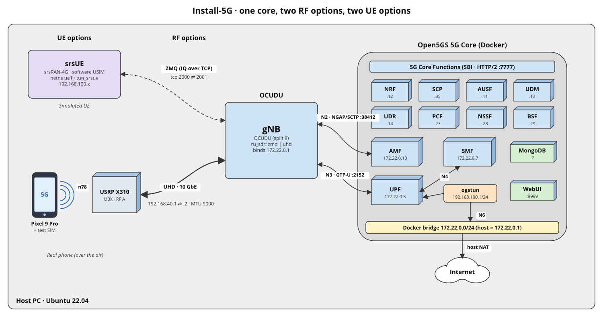

# Install 5G: Open5GS + OCUDU testbed, multi-UE experiments and capture

Step-by-step guides for building a private **5G Standalone (SA)** network on one Linux PC, then using it for **control-plane research**: many simulated UEs, packet capture at the core, and analysis.



> ⚠️ **Regulatory note:** transmitting on cellular bands requires a licence from your national regulator, or a shielded / cabled setup. The ZMQ and UERANSIM setups transmit nothing.

---

## Guides

| # | Guide | What you get |
|---|---|---|
| **1** | [**Testbed setup**](docs/01-testbed-setup.md) | Open5GS 5G core in Docker + OCUDU gNB, with a virtual radio (ZMQ) and srsUE, or a USRP X310 and a real phone. Optional O-RAN near-RT RIC and xApps. |
| **2** | [**Multi-UE experiments and capture**](docs/02-multi-ue-and-capture.md) | UERANSIM next to OCUDU with up to hundreds of UEs, the capture and analysis tools (tcpdump, Wireshark/tshark, Python), labelled experiment runs, and CSV export of NGAP / NAS-5GS / SBI traffic. |

Follow guide 1 first (at least the core, sections 3–5). Guide 2 builds on it.

---

## Repository layout

```
README.md                         this page
docs/
  01-testbed-setup.md             guide 1: core, gNB, UEs, RIC
  02-multi-ue-and-capture.md      guide 2: UERANSIM, capture, analysis
  images/  diagrams/              architecture drawings and their source
configs/
  gnb_zmq.yml  gnb_x310.yml       OCUDU gNB (guide 1)
  ue_zmq.conf                     srsUE (guide 1)
  e2_ric.yml                      E2 / metrics block for the RIC (guide 1)
  ueransim_gnb.yaml               UERANSIM gNB (guide 2)
  ueransim_ue.yaml                UERANSIM UE template (guide 2)
scripts/
  install_analysis_tools.sh       tcpdump, Wireshark/tshark, jq, Python venv
  setup_ueransim_ip.sh            172.22.0.200 alias on the Docker bridge
  add_ueransim_subscribers.sh     consecutive IMSI range in the Open5GS DB
  run_experiment.sh               one labelled run: capture + UEs + logs + metrics
  pcap_to_csv.sh                  NGAP/NAS and SBI to CSV
  registration_summary.py         per-run sanity summary
```

---

## Quick start for guide 2 (core already running)

```bash
cd ~/5g && git clone https://github.com/Hasan-Ali-Jebur/Install-5G-.git && cd Install-5G-
./scripts/install_analysis_tools.sh
./scripts/setup_ueransim_ip.sh
./scripts/add_ueransim_subscribers.sh 100
cp configs/ueransim_gnb.yaml configs/ueransim_ue.yaml ~/5g/

sudo ~/5g/UERANSIM/build/nr-gnb -c ~/5g/ueransim_gnb.yaml &       # after building UERANSIM (guide 2, 2.1)
sudo ./scripts/run_experiment.sh -l benign -n 10 -t 1000 -H 30
./scripts/pcap_to_csv.sh ~/5g/runs/<run folder>
```
