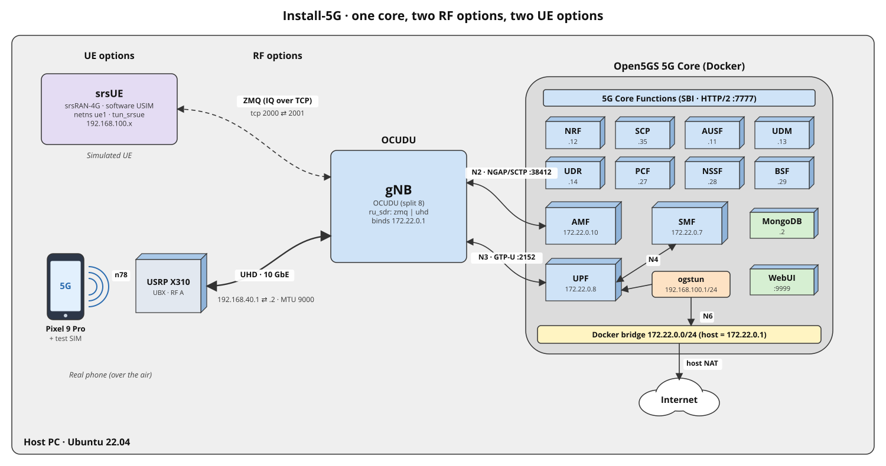
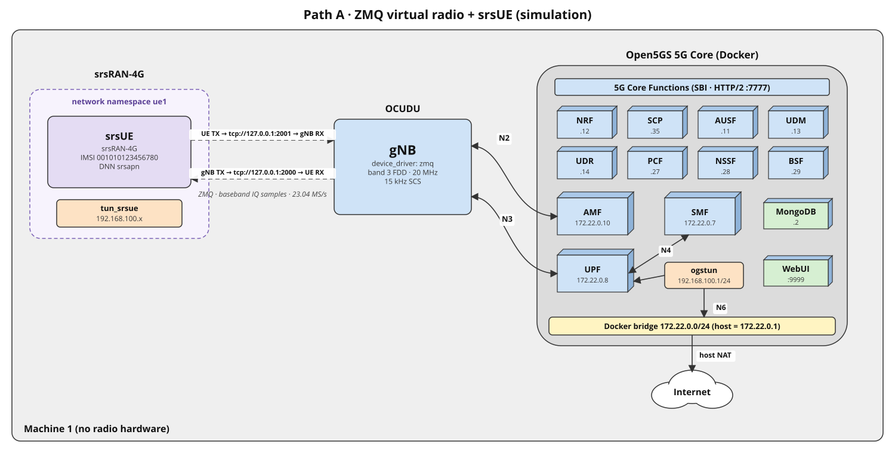
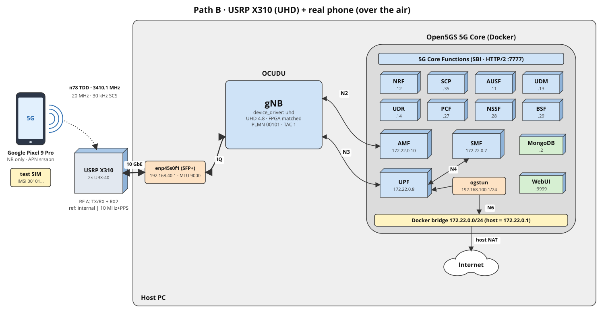
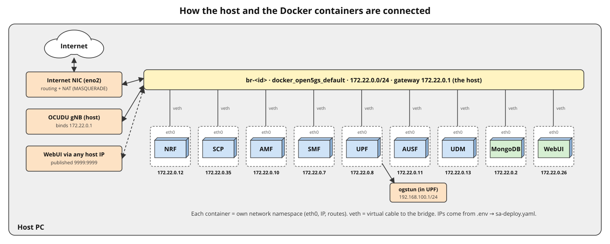
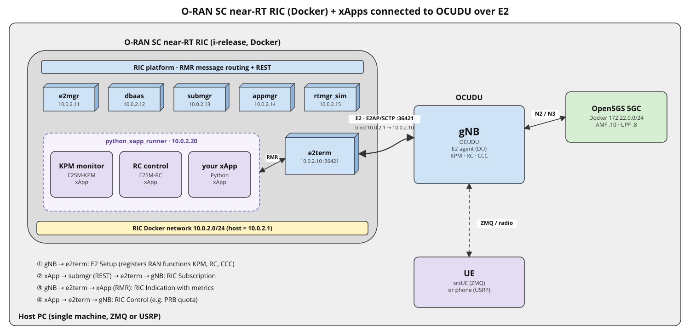

# Install 5G: Open5GS + OCUDU, with a USRP or ZMQ, and a real phone or simulated UE

A step-by-step guide to building a private **5G Standalone (SA)** network on one Linux PC. You choose:

- **Radio:** a real SDR (**USRP X310 via UHD**) or a **virtual radio (ZMQ)** with no hardware
- **UE:** a **real phone** (Google Pixel + programmable SIM) or a **simulated UE (srsUE)**

The 5G core (Open5GS in Docker) and the gNB (OCUDU) are the same in every case.



> ⚠️ **Regulatory note:** transmitting on cellular bands requires a licence from your national regulator, or a shielded / cabled setup. The ZMQ path transmits nothing.

---

## Choose your path

| Path | Radio | UE | Hardware needed | Best for |
|---|---|---|---|---|
| **A: Simulation** | 🔵 ZMQ | 🧪 srsUE | **None** | Learning, development, core / security research |
| **B: Over the air** | 🟢 UHD (USRP X310) | 📱 Real phone | X310, antennas, test SIM, SIM reader, 5G SA phone | Real-world testing with commercial devices |
| **C: OTA with srsUE** *(advanced)* | 🟢 UHD | 🧪 srsUE on a 2nd SDR | Two SDRs (+ shared clock recommended) | Controlled RF experiments |

A real phone needs a real radio, so **ZMQ + phone is not possible**.

**Optional add-on, for any path:** connect OCUDU to the **O-RAN SC near-RT RIC** and run **xApps** over E2 (section 15).

Throughout the guide, steps are tagged:

| Tag | Follow it if you use |
|---|---|
| ⚪ **[ALL]** | every path |
| 🔵 **[ZMQ]** | the ZMQ virtual radio (path A) |
| 🟢 **[UHD]** | a USRP (paths B, C) |
| 📱 **[PHONE]** | a real phone (path B) |
| 🧪 **[srsUE]** | the simulated UE (paths A, C) |

**Section map**

| Section | Path A | Path B | Path C |
|---|:---:|:---:|:---:|
| [1. Architecture](#1-architecture) | ✅ | ✅ | ✅ |
| [2. Requirements](#2-requirements) | ✅ | ✅ | ✅ |
| [3. Host preparation](#3-host-preparation) | ✅ | ✅ (+3.5) | ✅ (+3.5) |
| [4. Open5GS 5G core](#4-open5gs-5g-core-in-docker) | ✅ | ✅ | ✅ |
| [5. Docker networking explained](#5-how-docker-networking-connects-everything) | 📖 | 📖 | 📖 |
| [6. UHD and the USRP X310](#6-uhd-and-the-usrp-x310--uhd) | – | ✅ | ✅ |
| [7. Build OCUDU](#7-build-ocudu--all) | ✅ | ✅ | ✅ |
| [8. gNB configuration](#8-gnb-configuration) | 8A | 8B | 8C |
| [9. UE: real phone](#9-ue-option-1-real-phone--phone) | – | ✅ | – |
| [10. UE: srsUE](#10-ue-option-2-simulated-ue-srsue--srsue) | ✅ | – | ✅ |
| [11. Run](#11-run-the-network) | 11A | 11B | 11C |
| [12. Verify and test](#12-verify-and-test-connectivity--all) | ✅ | ✅ | ✅ |
| [13. Stop](#13-stop-the-network--all) · [14. Troubleshooting](#14-troubleshooting) | ✅ | ✅ | ✅ |
| [15. O-RAN near-RT RIC + xApps](#15-o-ran-near-rt-ric-and-xapps--all) *(optional add-on)* | ➕ | ➕ | ➕ |

---

## 1. Architecture

### Path A: ZMQ + srsUE (no hardware)



The gNB and srsUE exchange **baseband IQ samples over local TCP sockets** instead of radio waves. The ports are crossed: the gNB transmits on `2000`, which the UE receives on, and the UE transmits on `2001`, which the gNB receives on. Everything above the radio (RRC, NAS, NGAP, authentication, PDU sessions, GTP-U) is the real 5G stack.

### Path B: USRP X310 + real phone



The gNB runs on the host and streams IQ samples to the X310 over 10 GbE. The phone attaches over the air (n78 TDD) using a programmable test SIM.

### Key idea for every path

The core runs in containers on a private **Docker bridge** (`172.22.0.0/24`). The **host is plugged into that bridge as `172.22.0.1`**, so the gNB on the host reaches the AMF (`172.22.0.10`, N2) and the UPF (`172.22.0.8`, N3) directly, with no port publishing needed.

---

## 2. Requirements

| Item | Path A (ZMQ) | Path B (UHD + phone) |
|---|---|---|
| OS | Ubuntu 22.04 LTS (bare metal or VM) | Ubuntu 22.04 LTS (bare metal) |
| CPU | **≥ 6 cores** (ZMQ processes samples in real time) | ≥ 8 cores |
| RAM | ≥ 8 GB | ≥ 16 GB |
| Disk | ~15 GB | ~25 GB |
| SDR | none | USRP X310 (e.g. 2 × UBX-40, **40 MHz max analog bandwidth**) |
| Network | – | 10 GbE SFP+ NIC for the X310 |
| Antennas | – | rated for your band (e.g. **3.3–3.8 GHz** for n78) |
| Clock | – | internal; an external 10 MHz + PPS reference (OctoClock / clock distributor) improves stability with phones |
| UE | srsUE (software) | 5G SA phone (e.g. Google Pixel 9 Pro) |
| SIM | software USIM | programmable SIM (e.g. sysmoISIM-SJA5) + data sheet (IMSI, Ki, OPc, ADM1) + PC/SC reader |

---

## 3. Host preparation

### 3.1 Base packages ⚪ [ALL]

```bash
sudo apt update
sudo apt install -y git curl build-essential cmake make gcc g++ pkg-config \
  libfftw3-dev libmbedtls-dev libsctp-dev libyaml-cpp-dev libgtest-dev \
  libzmq3-dev iperf3
```

`libzmq3-dev` is small. Installing it on every machine lets one OCUDU build support **both** ZMQ and UHD (section 7).

### 3.2 Install Docker ⚪ [ALL]

```bash
curl -fsSL https://get.docker.com | sh
sudo usermod -aG docker $USER
newgrp docker
docker --version && docker compose version
```

### 3.3 Make sure DNS works inside Docker ⚪ [ALL]

On some networks (universities, companies, filtering ISPs), public resolvers such as `8.8.8.8` are blocked. Containers can't use the host's local resolver (`127.0.0.53`) and fall back to `8.8.8.8`, so `docker build` fails with `curl: (6) Could not resolve host`.

```bash
getent hosts www.mongodb.org                          # host resolves?
docker run --rm busybox nslookup www.mongodb.org      # container resolves?
```

If the container fails, find your network's DNS servers and give them to Docker (merge the `dns` key by hand if `/etc/docker/daemon.json` already exists):

```bash
resolvectl status | grep -A2 "DNS Servers"            # or: nmcli dev show | grep -i IP4.DNS

sudo tee /etc/docker/daemon.json <<'EOF'
{
  "dns": ["<DNS server 1>", "<DNS server 2>"]
}
EOF
sudo systemctl restart docker                          # stops running containers
docker run --rm busybox nslookup www.mongodb.org
```

Quick alternative for a single build: `docker build --network host ...`.

### 3.4 Kernel, firewall and leftovers ⚪ [ALL]

```bash
# IP forwarding (UE internet access)
echo "net.ipv4.ip_forward=1" | sudo tee /etc/sysctl.d/99-open5gs.conf
sudo sysctl --system

# Firewall
sudo ufw disable

# Leftovers from a native (non-Docker) Open5GS install conflict with the Docker core
sudo systemctl stop 'open5gs-*' 2>/dev/null; sudo systemctl disable 'open5gs-*' 2>/dev/null
ip link show ogstun 2>/dev/null && sudo ip link del ogstun

# Old Docker networks from other projects (srsRAN docker_ran, O-RAN SC RIC, ...)
docker network ls
docker network prune
```

### 3.5 Network for the USRP 🟢 [UHD]

Identify your interfaces:

```bash
ip -br addr
```

Example used in this guide:

| Interface | IP | Purpose |
|---|---|---|
| `eno2` | your network IP | Internet uplink |
| `eno1` | e.g. `10.5.48.1/16` | Optional direct link to another PC (SSH, WebUI) |
| `enp45s0f1` | `192.168.40.1/24` | 10 GbE to the X310 |

Set jumbo frames on the X310 port permanently (NetworkManager), and enlarge the socket buffers:

```bash
nmcli -f NAME,DEVICE con show
sudo nmcli con mod "<X310 connection name>" 802-3-ethernet.mtu 9000
sudo nmcli con up "<X310 connection name>"
ip link show enp45s0f1 | grep mtu                       # mtu 9000

sudo tee /etc/sysctl.d/99-uhd.conf <<'EOF'
net.core.wmem_max=33554432
net.core.rmem_max=33554432
EOF
sudo sysctl --system
```

---

## 4. Open5GS 5G Core in Docker

### 4.1 Clone and build ⚪ [ALL]

```bash
mkdir -p ~/5g && cd ~/5g
git clone https://github.com/herlesupreeth/docker_open5gs
cd docker_open5gs
cd base && docker build --no-cache --force-rm -t docker_open5gs . && cd ..
```

### 4.2 Configure `.env` ⚪ [ALL]

```bash
nano .env
```

```
MCC=001
MNC=01
TAC=1
DOCKER_HOST_IP=<one of your host IPs>
UE_IPV4_INTERNET=192.168.100.0/24
SMF_DNS1=<DNS server reachable from your network>
SMF_DNS2=<DNS server reachable from your network>
```

- `DOCKER_HOST_IP` defaults to a placeholder (`192.168.1.223`), so set a real host IP. When the gNB runs on the same host, its value has little effect.
- **DNS for the UE:** the SMF sends `SMF_DNS1`/`SMF_DNS2` to every UE in the PDU Session Establishment Accept (ePCO). If public DNS works on your network, `8.8.8.8` / `8.8.4.4` are fine. Many networks block it, though. Test, and if needed use your network's own resolvers:

  ```bash
  nslookup google.com 8.8.8.8                       # timeout → public DNS blocked
  resolvectl status | grep -A2 "DNS Servers"        # your network's resolvers
  sed -i 's/^SMF_DNS1=.*/SMF_DNS1=<DNS server 1>/; s/^SMF_DNS2=.*/SMF_DNS2=<DNS server 2>/' .env
  grep -E "^SMF_DNS" .env
  ```

  After changing `.env` later on, recreate the core (`docker compose -f sa-deploy.yaml down && docker compose -f sa-deploy.yaml up -d`), then reconnect the UEs.

### 4.3 Set the DNN (APN) to `srsapn` ⚪ [ALL]

The DNN must be **identical** in the SMF/UPF, in the subscriber record, and on the UE (phone APN or srsUE `[nas] apn`). This guide uses `srsapn` for every UE type:

```bash
sed -i 's/dnn: internet/dnn: srsapn/' smf/smf.yaml upf/upf.yaml
grep -n "dnn:" smf/smf.yaml upf/upf.yaml       # srsapn (and ims)
```

### 4.4 Start and verify ⚪ [ALL]

```bash
set -a; source .env; set +a
docker compose -f sa-deploy.yaml build
docker compose -f sa-deploy.yaml up -d
docker ps --format "table {{.Names}}\t{{.Status}}"       # 15 containers "Up"

ping -c 2 172.22.0.10                                    # host → AMF
docker logs amf 2>&1 | grep ngap_server | tail -1        # [172.22.0.10]:38412
docker exec -it upf ip -br addr                          # eth0 172.22.0.8, ogstun 192.168.100.1
docker exec -it upf ping -c 2 8.8.8.8                    # UPF → internet (N6 + NAT)
docker exec amf sh -c 'grep -A2 "plmn_id" $(find / -name amf.yaml -path "*open5gs*" | head -1)' | head -3
```

### 4.5 Container IPs ⚪ [ALL]

| Component | IP | Key ports |
|---|---|---|
| Host on the Docker bridge | 172.22.0.1 | gNB `bind_addrs` |
| MongoDB | 172.22.0.2 | 27017 |
| SMF | 172.22.0.7 | 8805/udp (PFCP), 7777 (SBI) |
| UPF | 172.22.0.8 | 2152/udp (N3), 8805/udp (N4) |
| **AMF** | **172.22.0.10** | **38412/sctp (N2)**, 7777 |
| AUSF | 172.22.0.11 | 7777 |
| NRF | 172.22.0.12 | 7777 |
| UDM | 172.22.0.13 | 7777 |
| UDR | 172.22.0.14 | 7777 |
| WebUI | 172.22.0.26 | 9999 (`admin` / `1423`) |
| PCF | 172.22.0.27 | 7777 |
| NSSF | 172.22.0.28 | 7777 |
| BSF | 172.22.0.29 | 7777 |
| SCP | 172.22.0.35 | 7777 |
| Prometheus / Grafana | 172.22.0.36 / .39 | 9090 / 3000 |
| UE pool (`srsapn`) | 192.168.100.0/24 | gateway 192.168.100.1 |

The WebUI is published on every host interface (`9999:9999/tcp`), so it is reachable at `http://<any host IP>:9999`.

---

## 5. How Docker networking connects everything



- **Each container** has its own network namespace: its own `eth0`, IP and routing table.
- **The Docker bridge** (`br-<id>`, `172.22.0.1`) is a virtual switch on the host. Compose creates it as `docker_open5gs_default` from `TEST_NETWORK` in `.env`.
- **veth pairs** are virtual cables: `eth0` inside each container ↔ `vethXXXX` on the host.
- **The host** is the router: it reaches every container directly and NATs container traffic to the internet.
- **IPs** are fixed: `.env` → `sa-deploy.yaml` (`ipv4_address: ${AMF_IP}`) → each NF's config, filled in at container start.

| Interface | Between | Protocol |
|---|---|---|
| SBI | all NFs ↔ NRF / SCP | HTTP/2, 7777 |
| N2 | gNB ↔ AMF | SCTP, 38412 |
| N4 | SMF ↔ UPF | PFCP, UDP 8805 |
| N3 | gNB ↔ UPF | GTP-U, UDP 2152 |
| N6 | UPF → internet | IP via `ogstun` + NAT |

```bash
docker network inspect docker_open5gs_default | grep -E '"Name"|IPv4Address|Gateway|Subnet'
ip -br addr | grep -E "br-|veth"
ip route | grep 172.22
sudo tcpdump -i br-<id> -n port 7777 or sctp            # watch the NFs talk
```

---

## 6. UHD and the USRP X310 🟢 [UHD]

### 6.1 Keep exactly **one** UHD install

Mixed installs (apt/PPA in `/usr/bin` plus source builds in `/usr/local`) cause hard-to-debug errors:

```bash
which -a uhd_usrp_probe
uhd_config_info --version
ls /usr/local/lib | grep -i uhd
dpkg -l | grep -i uhd
```

This guide uses **UHD 4.8 built from source** in `/usr/local`. To remove an apt/PPA copy, use the **exact package names**. Don't use `libuhd*`, which would also remove GNU Radio's dependency:

```bash
sudo apt remove --purge uhd-host libuhd-dev libuhd4.11.0 python3-uhd uhd-rfnoc-dev
sudo add-apt-repository --remove ppa:ettusresearch/uhd
sudo ldconfig && hash -r
which -a uhd_usrp_probe          # only /usr/local/bin
```

(With no UHD at all, install one version, either from source or from the Ettus PPA, and stick to it.)

### 6.2 Probe the X310

```bash
uhd_find_devices
sudo uhd_usrp_probe --args "type=x300,addr=192.168.40.2"
```

The X310's default addresses are listed by the probe as `ip-addr0..3`: `192.168.10.2`, `192.168.20.2` (1 GbE), `192.168.30.2`, `192.168.40.2` (10 GbE).

**FPGA/UHD mismatch errors** mean the FPGA image was flashed by a different UHD version:

| Error | Meaning |
|---|---|
| `Major compat number mismatch ... revision 1 and UHD supports revision 0` | FPGA newer than UHD |
| `RFNoC protocol mismatch (SW: 2.0, HW: 1.0)` | FPGA older than UHD |

Flash the image that matches **your** UHD (using that UHD's tools), then **power-cycle** the X310:

```bash
sudo uhd_images_downloader -t x310
uhd_image_loader --args "type=x300,addr=192.168.40.2,fpga=HG"   # HG = default image
```

### 6.3 Benchmark the link

```bash
sudo /usr/local/lib/uhd/examples/benchmark_rate \
  --args "type=x300,addr=192.168.40.2,master_clock_rate=184.32e6" \
  --rx_rate 23.04e6 --tx_rate 23.04e6 --duration 10
```

Expect **0 dropped samples, 0 overruns, 0 underruns, 0 sequence errors**.

---

## 7. Build OCUDU ⚪ [ALL]

**One OCUDU binary can drive both radios.** The radio is chosen at runtime by `device_driver` (`zmq` or `uhd`) in the gNB config. Support for each is compiled in when its library is present at build time: `libzmq3-dev` for ZMQ, and UHD (section 6) for USRPs.

```bash
cd ~/5g
git clone https://gitlab.com/ocudu/ocudu.git
cd ocudu && mkdir -p build && cd build
cmake ../ -DDU_SPLIT_TYPE=SPLIT_8 -DENABLE_EXPORT=ON -DENABLE_ZEROMQ=ON -DBUILD_TESTING=OFF 2>&1 | tee cmake.log
grep -i -E "uhd|zmq|zeromq" cmake.log
make -j $(nproc)

ls -l apps/gnb/gnb
ldd apps/gnb/gnb | grep -E "uhd|zmq"                     # 🟢 libuhd.so.4.8.0 · 🔵 libzmq
```

At startup the gNB prints the radios it supports, for example:

```
Available radio types: uhd, zmq, difi and realtime_loopback.
```

On a machine without UHD (path A only), `uhd` is simply missing from that list. That's fine.

---

## 8. gNB configuration

The gNB reads its config **only at startup**: stop it (Ctrl+C) before editing, then start it again. If OCUDU rejects `addrs` / `bind_addrs`, use the older key names `addr` / `bind_addr`.

### 8A. ZMQ cell for srsUE 🔵 [ZMQ]

Copy [`configs/gnb_zmq.yml`](configs/gnb_zmq.yml) to `~/5g/gnb_zmq.yml`:

```yaml
cu_cp:
  amf:
    addrs: 172.22.0.10          # AMF container
    port: 38412
    bind_addrs: 172.22.0.1      # host side of the Docker bridge
    supported_tracking_areas:
      - tac: 1                  # = TAC in .env
        plmn_list:
          - plmn: "00101"       # = MCC+MNC in .env
            tai_slice_support_list:
              - sst: 1
  inactivity_timer: 7200        # keep the simulated UE connected

cu_up:
  ngu:
    socket:
      - bind_addr: 172.22.0.1   # N3 towards UPF 172.22.0.8

ru_sdr:
  device_driver: zmq
  device_args: tx_port=tcp://127.0.0.1:2000,rx_port=tcp://127.0.0.1:2001,base_srate=23.04e6
  srate: 23.04
  tx_gain: 0                   # ZMQ: OCUDU requires gain <= 0 dB
  rx_gain: 0

cell_cfg:
  dl_arfcn: 368500              # band 3 FDD
  band: 3
  channel_bandwidth_MHz: 20
  common_scs: 15
  plmn: "00101"
  tac: 1
  pci: 1
  pdcch:                        # required to match srsUE capabilities
    common:
      ss0_index: 0
      coreset0_index: 12
    dedicated:
      ss2_type: common
      dci_format_0_1_and_1_1: false
  prach:
    prach_config_index: 1
  pdsch:
    mcs_table: qam64
  pusch:
    mcs_table: qam64

log:
  filename: /tmp/gnb.log
  all_level: info
  hex_max_size: 0

pcap:
  mac_enable: false
  mac_filename: /tmp/gnb_mac.pcap
  ngap_enable: true
  ngap_filename: /tmp/gnb_ngap.pcap
```

- **srsUE only supports FDD with 15 kHz SCS** for 5G SA, so this cell is band 3 FDD, 20 MHz.
- The `pdcch` / `prach` overrides select configurations srsUE can decode.
- With ZMQ nothing is transmitted, so the frequency is only a label.

### 8B. X310 cell for a real phone 🟢 [UHD] 📱 [PHONE]

Copy [`configs/gnb_x310.yml`](configs/gnb_x310.yml) to `~/5g/gnb_x310.yml`:

```yaml
cu_cp:
  amf:
    addrs: 172.22.0.10
    port: 38412
    bind_addrs: 172.22.0.1
    supported_tracking_areas:
      - tac: 1
        plmn_list:
          - plmn: "00101"       # = first 5 digits of the SIM's IMSI
            tai_slice_support_list:
              - sst: 1

cu_up:
  ngu:
    socket:
      - bind_addr: 172.22.0.1

ru_sdr:
  device_driver: uhd
  device_args: type=x300,addr=192.168.40.2,master_clock_rate=184.32e6,send_frame_size=8000,recv_frame_size=8000
  clock: internal               # 'external' with a 10 MHz + PPS reference
  sync: internal
  srate: 23.04                  # 184.32 / 8 → 20 MHz carrier
  tx_gain: 30
  rx_gain: 30
  time_alignment_calibration: auto

cell_cfg:
  dl_arfcn: 627340              # 3410.1 MHz, n78 TDD
  band: 78
  channel_bandwidth_MHz: 20
  common_scs: 30
  plmn: "00101"
  tac: 1
  pci: 1

log:
  filename: /tmp/gnb.log
  all_level: info

pcap:
  ngap_enable: true
  ngap_filename: /tmp/gnb_ngap.pcap
```

- With **UBX-40** daughterboards keep the carrier at **20 MHz** (40 MHz fills the whole analog bandwidth).
- The X310 sample rate must divide the master clock: 23.04 (20 MHz), 46.08 (40 MHz), 92.16 (80 MHz) at 184.32 MHz.
- Use a frequency your licence or test setup allows.

### 8C. X310 cell for srsUE on a second SDR 🟢 [UHD] 🧪 [srsUE] *(advanced)*

Start from **8A** (band 3 FDD, 15 kHz, srsUE `pdcch`/`prach` settings) and replace only `ru_sdr` with the X310 block from **8B** (`device_driver: uhd`, X310 `device_args`, gains, clock). Connect both SDRs to a common 10 MHz + PPS reference, or cable them through attenuators. See [uoy-research/srsRAN-USRPs-OTA](https://github.com/uoy-research/srsRAN-USRPs-OTA) for a two-X310 example.

---

## 9. UE option 1: real phone 📱 [PHONE]

### 9.1 Install pySim and the reader driver

```bash
sudo apt install -y pcscd pcsc-tools libccid libpcsclite-dev python3-pyscard \
  python3-setuptools python3-pycryptodome python3-pip
sudo systemctl enable --now pcscd

cd ~/5g
git clone https://gitea.osmocom.org/sim-card/pysim.git
cd pysim
pip3 install --user -r requirements.txt

pcsc_scan          # reader listed + "Card inserted"
```

`libccid` is needed for most USB readers. Without it pySim reports `No reader found for number 0`.

### 9.2 Read the card

```bash
./pySim-read.py -p0
```

Note the **IMSI**, **ICCID**, **FPLMN** list and **USIM Service Table**.

### 9.3 Match the SIM's home network to your PLMN

The **first 5 digits of the IMSI are the SIM's home network** (MCC + MNC) and must match the network's PLMN. sysmocom cards often ship with `99970…`, and Pixel phones work best with **00101**. You have two options:

- **Reprogram the SIM to 00101** (recommended for Pixels). Pass the **Ki / OPc from the data sheet** with `-k` / `-o` to keep the original keys. Without them, pySim generates new random keys that you must note down.

  ```bash
  ./pySim-prog.py -p0 -s <ICCID> --mcc=001 --mnc=01 -a <ADM1> \
    --imsi=00101<last 10 digits of the original IMSI> \
    -k <Ki> -o <OPc>
  ./pySim-read.py -p0 | grep -E "IMSI|ICCID"
  ```

- **Or keep the SIM** and set the core and gNB to the SIM's PLMN: `MCC`/`MNC` in `.env` (then `docker compose down && up -d`), and `plmn` in the gNB config.

> ⚠️ A wrong **ADM1** key ~3 times **locks the card permanently**. If pySim reports an ADM error, stop and double-check. Don't retry blindly.

### 9.4 Disable SUCI concealment (if enabled)

```bash
./pySim-read.py -p0 | grep -E "Service 12[2-5]"
```

If services **124** or **125** are listed:

```bash
./pySim-shell.py -p0
pySIM-shell (MF)> verify_adm <ADM1>
pySIM-shell (MF)> select MF/ADF.USIM/EF.UST
pySIM-shell (MF/ADF.USIM/EF.UST)> ust_service_deactivate 124
pySIM-shell (MF/ADF.USIM/EF.UST)> ust_service_deactivate 125
pySIM-shell (MF/ADF.USIM/EF.UST)> quit
```

### 9.5 Check the forbidden-network list (FPLMN)

After a rejected registration the phone may write your PLMN into the SIM's forbidden list and stop trying:

```bash
./pySim-read.py -p0 | grep -A5 "FPLMN"
```

If `00f110` (MCC 001 / MNC 01) appears, clear the list:

```bash
./pySim-shell.py -p0
verify_adm <ADM1>
select MF/ADF.USIM/EF.FPLMN
update_binary ffffffffffffffffffffffff
quit
```

### 9.6 Add the subscriber

Use the **same IMSI, Ki and OPc as the card**. A mismatch is the most common cause of authentication failures.

```bash
cd ~/5g/docker_open5gs
docker exec -it webui misc/db/open5gs-dbctl add_ue_with_apn <IMSI> <Ki> <OPc> srsapn
docker exec webui misc/db/open5gs-dbctl showpretty | grep -E "imsi|name|ipv4"
# replace an old entry:  docker exec -it webui misc/db/open5gs-dbctl remove <old IMSI>
```

Or use the WebUI (`http://<host IP>:9999`, `admin` / `1423`): IMSI, K, **OPc** (select the OPc type!), AMF `8000`, SST `1`, DNN `srsapn`, IPv4.

### 9.7 Configure the phone (Google Pixel)

**Settings → Network & internet → SIMs → [your SIM]:**

| Setting | Value |
|---|---|
| Use SIM | ON (disable other SIMs / eSIMs while testing) |
| Mobile data | ON |
| Roaming | ON |
| Preferred network type | 5G (recommended) |
| Automatically select network | ON |
| Allow 2G | OFF |
| Carrier settings version | should start with `test001` (test SIM recognised) |

**Access Point Names → +**

| Field | Value |
|---|---|
| Name / APN | `srsapn` / `srsapn` |
| MCC / MNC | `001` / `01` (auto-filled from the IMSI) |
| APN type | `default` |
| APN protocol / roaming protocol | IPv4 / IPv4 |
| Everything else | Not set |

Save via **⋮ → Save**, then **select** the APN.

**Force 5G NR only**

1. Enable Developer options: **Settings → About phone →** tap **Build number** 7 times.
2. Dial `*#*#4636#*#*` → **Phone information**.
3. On dual-SIM phones, pick the **correct phone index / SIM** at the top.
4. **Set preferred network type → NR only**. This can **reset after a reboot**, so re-check it.

**Prevent disconnects (IMS timers):** dial `*#*#0702#*#*` and set `NR_TIMER_WAIT_IMS_REGISTRATION` = `-1` and `SUPPORT_IMS_NR_REGISTRATION_TIMER` = `0`. These are per-SIM and survive reboots.

### 9.8 Inspect the phone over USB (adb)

Enable **USB debugging** in Developer options and connect the phone to the host:

```bash
sudo apt install -y adb
adb devices
adb shell getprop gsm.sim.operator.numeric                                  # 00101
adb shell dumpsys carrier_config | grep -i carrier_nr_availabilities        # [1, 2] → SA allowed
adb shell dumpsys telephony.registry | grep -o "getRilDataRadioTechnology=[0-9]*([A-Z]*)" | tail -1
#   14(LTE) = NR-only not active · 20(NR) = on 5G · 0(Unknown) = searching
adb logcat -b radio -c        # then toggle airplane mode and wait 60 s:
adb logcat -b radio -d | grep -i -E "reject|cause|registration|00101|IN_SERVICE" | tail -40
```

If the phone reports **LTE** and lists local operators as "emergency only", NR-only isn't active, so it will never scan for your cell.

---

## 10. UE option 2: simulated UE (srsUE) 🧪 [srsUE]

### 10.1 Build srsUE

srsUE is part of **srsRAN 4G** and supports 5G SA. ZMQ is detected automatically when `libzmq3-dev` is installed, and UHD when UHD is installed.

```bash
sudo apt install -y libboost-program-options-dev libconfig++-dev
cd ~/5g
git clone https://github.com/srsran/srsRAN_4G.git
cd srsRAN_4G && mkdir -p build && cd build
cmake ../ 2>&1 | tee cmake.log
grep -i -E "zeromq|uhd" cmake.log
make -j $(nproc) srsue
ls -l srsue/src/srsue
```

### 10.2 Add the simulated subscriber

These are the public example values from the srsRAN tutorials. They're fine for a lab, but change them for anything shared:

```bash
cd ~/5g/docker_open5gs
docker exec -it webui misc/db/open5gs-dbctl add_ue_with_apn 001010123456780 \
  00112233445566778899aabbccddeeff 63BFA50EE6523365FF14C1F45F88737D srsapn
docker exec webui misc/db/open5gs-dbctl showpretty | grep -E "imsi|name"
```

### 10.3 srsUE configuration 🔵 [ZMQ]

Copy [`configs/ue_zmq.conf`](configs/ue_zmq.conf) to `~/5g/ue_zmq.conf`:

```ini
[rf]
freq_offset = 0
tx_gain = 50
rx_gain = 40
srate = 23.04e6
nof_antennas = 1
device_name = zmq
device_args = tx_port=tcp://127.0.0.1:2001,rx_port=tcp://127.0.0.1:2000,base_srate=23.04e6

[rat.eutra]
dl_earfcn = 2850
nof_carriers = 0

[rat.nr]
bands = 3
nof_carriers = 1
max_nof_prb = 106
nof_prb = 106

[pcap]
enable = none
mac_filename = /tmp/ue_mac.pcap
mac_nr_filename = /tmp/ue_mac_nr.pcap
nas_filename = /tmp/ue_nas.pcap

[log]
all_level = info
phy_lib_level = none
all_hex_limit = 32
filename = /tmp/ue.log
file_max_size = -1

[usim]
mode = soft
algo = milenage
opc  = 63BFA50EE6523365FF14C1F45F88737D
k    = 00112233445566778899aabbccddeeff
imsi = 001010123456780
imei = 353490069873319

[rrc]
release = 15
ue_category = 4

[nas]
apn = srsapn
apn_protocol = ipv4

[gw]
netns = ue1
ip_devname = tun_srsue
ip_netmask = 255.255.255.0

[gui]
enable = false
```

- `nof_carriers = 0` under `[rat.eutra]` disables LTE, so the UE runs **5G SA only**.
- `nof_prb = 106` matches **20 MHz at 15 kHz SCS**. Use 52 for 10 MHz and 25 for 5 MHz, and change the gNB bandwidth and both `srate`/`base_srate` values to match.
- `netns = ue1` puts the UE's interface (`tun_srsue`) in its own **network namespace**, so its traffic really goes through the 5G network.
- `[usim]` and `[nas] apn` must match the subscriber (10.2).

**Path C (srsUE on an SDR) 🟢:** in `[rf]` set `device_name = uhd` and `device_args` for the second SDR (e.g. `type=x300,addr=<ip>,master_clock_rate=184.32e6,...`), and set `srate` to 23.04e6.

---

## 11. Run the network

Start the components in this order: **core → gNB → UE**.

### 11A. Path A: ZMQ + srsUE 🔵🧪

```bash
# Terminal 1: core
cd ~/5g/docker_open5gs && set -a; source .env; set +a
docker compose -f sa-deploy.yaml up -d
docker logs -f --tail 0 amf

# Terminal 2: gNB
cd ~/5g/ocudu/build/apps/gnb
sudo ./gnb -c ~/5g/gnb_zmq.yml

# Terminal 3: UE
sudo ip netns add ue1 2>/dev/null; sudo ip netns list
cd ~/5g/srsRAN_4G/build/srsue/src
sudo ./srsue ~/5g/ue_zmq.conf
```

With ZMQ, the gNB **waits** for the UE before its clock runs. That's normal.

> **Restarting the UE:** with ZMQ, srsUE can't reconnect to a gNB that's already running. If you stop srsUE, it hangs at `Attaching UE...` on the next start. Always stop **both** and start the **gNB first, then the UE**. The core can keep running. After each reconnect, re-add the namespace default route (section 12).

Expected UE output:

```
Attaching UE...
Random Access Transmission: ...
Random Access Complete.     c-rnti=0x4601, ta=0
RRC Connected
PDU Session Establishment successful. IP: 192.168.100.2
RRC NR reconfiguration successful.
```

### 11B. Path B: X310 + phone 🟢📱

```bash
# Terminal 1: core
cd ~/5g/docker_open5gs && set -a; source .env; set +a
docker compose -f sa-deploy.yaml up -d
docker logs -f --tail 0 amf

# Terminal 2: host tuning (resets on reboot) + gNB
cd ~/5g/ocudu && sudo ./scripts/ocudu_performance        # answer y to all
cd build/apps/gnb
sudo ./gnb -c ~/5g/gnb_x310.yml

# Terminal 3: RRC events
sudo tail -f /tmp/gnb.log | grep --line-buffered -E "rrcSetupRequest|rrcSetupComplete|rrcRelease|Reject"
```

Expected gNB output:

```
Cell pci=1, bw=20 MHz, 1T1R, dl_arfcn=627340 (n78), dl_freq=3410.1 MHz, dl_ssb_arfcn=626976, ul_freq=3410.1 MHz
Connected to AMF. Supported PLMNs: 00101
==== gNB started ===
```

Then toggle airplane mode on the phone. The warning `Attempting to set tick rate to 0. Skipping.` is harmless.

### 11C. Path C: X310 + srsUE on a second SDR 🟢🧪

Same as 11A, but with the gNB config from **8C**, `ocudu_performance`, and the srsUE `[rf]` changes from 10.3.

**Live metrics (all paths):** type `t` + Enter in the gNB console to show the UE table (MCS, throughput, BLER).

---

## 12. Verify and test connectivity ⚪ [ALL]

A successful attach looks like this:

| Where | What you see |
|---|---|
| AMF | `gNB-N2 accepted`, `Number of gNBs is now 1` |
| gNB log | `rrcSetupRequest` → `rrcSetupComplete` → NAS transfers (no immediate `rrcRelease`) |
| AMF / SMF | `Registration complete`, PDU session, UE IP `192.168.100.x` |
| UE | srsUE prints `PDU Session Establishment successful` / phone shows **5G** |

**Routes:**

```bash
# Host → UE subnet via the UPF container (all paths)
sudo ip route add 192.168.100.0/24 via 172.22.0.8

# 🧪 srsUE: default route inside the namespace
sudo ip netns exec ue1 ip route add default via 192.168.100.1 dev tun_srsue
```

**Ping:**

| Test | 🧪 srsUE | 📱 Phone (e.g. Termux) |
|---|---|---|
| Uplink → UPF | `sudo ip netns exec ue1 ping -c 4 192.168.100.1` | `ping 192.168.100.1` |
| Downlink → UE | `ping -c 4 192.168.100.<UE IP>` (host) | same |
| Internet | `sudo ip netns exec ue1 ping -c 4 1.1.1.1` | `ping 1.1.1.1` |
| DNS | see below | `ping google.com` |

🧪 **DNS inside the srsUE namespace:** srsUE receives the DNS servers from the core but **doesn't apply them**. Inside `ue1`, Linux falls back to the host's `/etc/resolv.conf` (`127.0.0.53`), which isn't reachable there, so names fail with `Temporary failure in name resolution`. Give the namespace its own resolver file, using the same servers as `SMF_DNS1/2`:

```bash
sudo ip netns exec ue1 nslookup google.com 8.8.8.8          # timeout → public DNS blocked here
resolvectl status | grep -A2 "DNS Servers"                  # host: your network's resolvers

sudo mkdir -p /etc/netns/ue1
printf "nameserver <DNS server 1>\nnameserver <DNS server 2>\n" | sudo tee /etc/netns/ue1/resolv.conf
sudo ip netns exec ue1 ping -c 3 google.com
```

The file persists, so you set it once. A 📱 phone applies the core's DNS automatically (check with `adb shell dumpsys connectivity | grep -i dns`).

**Throughput (iperf3):**

```bash
iperf3 -s -B 172.22.0.1                                         # server on the host
sudo ip netns exec ue1 iperf3 -c 172.22.0.1 -i 1 -t 30          # 🧪 uplink
sudo ip netns exec ue1 iperf3 -c 172.22.0.1 -i 1 -t 30 -R       # 🧪 downlink
```

ZMQ throughput depends on CPU speed. It's a functional test, not a benchmark.

**Capture N2 / N3 traffic (great for security research):**

```bash
sudo tcpdump -i $(ip -br link | awk '/^br-/{print $1; exit}') -w /tmp/5g_core.pcap 'sctp or udp port 2152'
```

Open the capture in Wireshark. With `NEA0` (null ciphering, the Open5GS default first choice), NAS registration and authentication messages are readable.

---

## 13. Stop the network ⚪ [ALL]

```bash
# UE: Ctrl+C (srsUE) / airplane mode (phone)
# gNB: Ctrl+C
cd ~/5g/docker_open5gs && docker compose -f sa-deploy.yaml down
sudo ip netns delete ue1 2>/dev/null                     # 🧪 optional
sudo ip route del 192.168.100.0/24 via 172.22.0.8        # optional
```

---

## 14. Troubleshooting

### Core, Docker and network ⚪

| Symptom | Cause | Fix |
|---|---|---|
| `docker build`: `Could not resolve host` | DNS blocked inside containers | 3.3 |
| gNB: no `Connected to AMF` | Core down / wrong IPs | `ping 172.22.0.10`, `addrs`/`bind_addrs` as in section 8 |
| NG Setup failure | PLMN or TAC mismatch | Same PLMN/TAC in `.env` and the gNB config |
| AMF: authentication / MAC failure | Ki/OPc/IMSI differ between the DB and the UE | Re-add the subscriber with the UE's values |
| AMF: registration rejected | IMSI prefix ≠ network PLMN | 9.3, or fix the srsUE `imsi` |
| Registered but PDU session fails / no data | DNN mismatch, stale static IP | `srsapn` in SMF/UPF, subscriber and UE |
| UE has IP but can't ping out | Missing routes | Section 12 routes; `docker exec upf ping 8.8.8.8` must work |
| Ping by IP works, names don't (`Temporary failure in name resolution`) | Public DNS blocked, or srsUE netns has no resolver | Network resolvers in `SMF_DNS1/2` (4.2) and in `/etc/netns/ue1/resolv.conf` (12) |
| Internet broken after an old native install | Stale host `ogstun` | `sudo ip link del ogstun` (3.4) |

### 🔵 ZMQ / 🧪 srsUE

| Symptom | Cause | Fix |
|---|---|---|
| `zmq` missing from `Available radio types` | OCUDU built without `libzmq3-dev` | Install it, rebuild OCUDU (section 7) |
| srsUE `Supported RF device list` lacks `zmq` | Same for srsRAN 4G | Install `libzmq3-dev`, delete `build/`, rebuild |
| gNB: `Channel gain must be <= 0.0 dB for ZMQ-device` | Gains > 0 in `ru_sdr` | Set `tx_gain: 0` and `rx_gain: 0` (8A) |
| Nothing happens after both start | Ports not crossed | gNB `tx=2000 / rx=2001`, UE `tx=2001 / rx=2000` |
| `srate` / `base_srate` errors | Rates differ | Same values on gNB and UE |
| UE stuck at `Attaching UE...` | Too few CPU cores / slow VM | ≥ 6 cores, close other loads |
| `Error opening netns` | Namespace missing | `sudo ip netns add ue1` |
| Restarting only the UE hangs at `Attaching UE...` | ZMQ stream stalled | Restart **gNB, then UE**. If still stuck: `sudo pkill -9 srsue; sudo pkill -9 gnb` and check `sudo ss -ltnp \| grep -E ":2000\|:2001"` is empty |

### 🟢 UHD / 📱 Phone

| Symptom | Cause | Fix |
|---|---|---|
| *compat number mismatch* / *RFNoC protocol mismatch* | FPGA built for another UHD | 6.2, then power-cycle |
| Several `uhd_usrp_probe` paths | Mixed apt + source UHD | 6.1; check `ldd gnb \| grep uhd` |
| *send buffer could not be resized* | Small socket buffers | 3.5 / `ocudu_performance` |
| Late / underflow / overflow counts keep rising | Host can't keep up or link problem | `ocudu_performance`, MTU 9000, rerun `benchmark_rate` |
| pySim: *No reader found for number 0* | CCID driver missing | `sudo apt install libccid && sudo systemctl restart pcscd` |
| Phone never appears in the gNB log | Phone on LTE / NR-only not set | 9.7; check with adb (9.8) |
| `rrcSetupComplete` then immediate `rrcRelease` | Core rejected registration | Read `docker logs amf` |
| Phone stops trying the network | PLMN added to FPLMN | 9.5 |
| Unstable cell / phone can't lock | Oscillator frequency error | External 10 MHz + PPS, `clock/sync: external` |

Logs: gNB `/tmp/gnb.log`, srsUE `/tmp/ue.log`, core `docker logs <amf|smf|upf|ausf|udm>`.

---

## 15. O-RAN: near-RT RIC and xApps ⚪ [ALL]

This **add-on** connects OCUDU to the **O-RAN Software Community (SC) near-RT RIC** over the **E2** interface, then runs **xApps** that read live RAN metrics (E2SM-KPM) and send control commands (E2SM-RC / E2SM-CCC). It works with **any path** (ZMQ + srsUE is the easiest way to start).



We use [srsran/oran-sc-ric](https://github.com/srsran/oran-sc-ric): a minimal **i-release** O-RAN SC RIC that runs with **Docker Compose** (no Kubernetes or Helm), plus a Python xApp framework and example xApps.

### 15.1 Components

| Container | IP | Role |
|---|---|---|
| `e2term` | **10.0.2.10** (SCTP **36421**) | E2 termination: the gNB's E2 agent connects here |
| `e2mgr` | 10.0.2.11 | Manages E2 nodes and connections |
| `dbaas` | 10.0.2.12 | Redis database (shared data layer) |
| `submgr` | 10.0.2.13 | Turns xApp subscriptions (REST) into E2 messages |
| `appmgr` | 10.0.2.14 | xApp manager |
| `rtmgr_sim` | 10.0.2.15 | Routing manager simulator (static RMR routes) |
| `python_xapp_runner` | 10.0.2.20 | Runs the Python xApps |
| Host on the RIC network | **10.0.2.1** | The gNB's E2 `bind_addrs` |

The RIC has its **own Docker network (`10.0.2.0/24`)**, separate from the core's (`172.22.0.0/24`). Just like with the core, the host sits on both bridges, so the gNB on the host reaches `e2term` directly.

How an xApp gets data:

1. **E2 Setup:** the gNB connects to `e2term` and announces its RAN functions (KPM, RC, CCC).
2. **Subscription:** the xApp asks `submgr` (REST), which sends an E2 *RIC Subscription* to the gNB.
3. **Indication:** the gNB periodically sends *RIC Indication* messages (metrics), which `e2term` delivers to the xApp over **RMR**.
4. **Control:** the xApp sends *RIC Control* requests (e.g. change a UE's PRB quota) back to the gNB.

### 15.2 Install and start the RIC

```bash
cd ~/5g
git clone https://github.com/srsran/oran-sc-ric.git
cd oran-sc-ric
docker compose up -d            # first run downloads and builds images (several minutes)
docker compose ps               # all services "running"
ip -br addr | grep 10.0.2.1     # new bridge for the RIC network
```

- If image builds fail with `Could not resolve host`, fix Docker DNS first (3.3).
- Make sure `10.0.2.0/24` isn't used by anything else on the host (`ip route | grep 10.0.2`).

### 15.3 Enable the E2 agent in OCUDU

Append the `e2` block to your gNB config, `~/5g/gnb_zmq.yml` or `~/5g/gnb_x310.yml` (also in [`configs/e2_ric.yml`](configs/e2_ric.yml)). Add it **once**, as a top-level section:

```bash
cat >> ~/5g/gnb_zmq.yml <<'EOF'

e2:
  enable_du_e2: true          # E2 agent in the DU (monolithic gNB = one E2 node)
  e2sm_kpm_enabled: true      # metrics (KPM)
  e2sm_rc_enabled: true       # RAN control (RC)
  e2sm_ccc_enabled: true      # cell configuration and control (CCC)
  addrs: 10.0.2.10            # RIC e2term
  bind_addrs: 10.0.2.1        # host on the RIC Docker network
  port: 36421
EOF
grep -n -A8 "^e2:" ~/5g/gnb_zmq.yml
```

- `enable_cu_cp_e2` / `enable_cu_up_e2` add CU-level E2 nodes (default `false`).
- If OCUDU rejects `addrs` / `bind_addrs`, use `addr` / `bind_addr` (the srsRAN key names).

### 15.4 Start order

**Core → RIC → gNB → UE**:

```bash
# 1. Core (if not running)
cd ~/5g/docker_open5gs && docker compose -f sa-deploy.yaml up -d

# 2. RIC (if not running)
cd ~/5g/oran-sc-ric && docker compose up -d

# 3. gNB (ZMQ example)
cd ~/5g/ocudu/build/apps/gnb && sudo ./gnb -c ~/5g/gnb_zmq.yml

# 4. UE: srsUE (11A) or phone (11B), then the routes from section 12
```

Check that the gNB registered with the RIC:

```bash
cd ~/5g/oran-sc-ric
docker compose logs e2mgr  | grep -i -E "setup|connected|gnb_"
docker compose logs e2term | grep -i -E "setup|sctp" | tail
```

> **60-second rule:** after the gNB disconnects, the RIC makes the E2 agent wait **60 s** before it may reconnect. If you restart the gNB sooner, the RIC answers `E2 SETUP FAILURE` and the gNB has no RIC connection. Wait a minute between gNB restarts (with ZMQ, also restart the UE afterwards).

### 15.5 Run the example xApps

All xApps run inside the `python_xapp_runner` container, from the `oran-sc-ric` folder. Generate traffic first so the metrics are non-zero:

```bash
# Terminal A: traffic (srsUE example, see section 12)
iperf3 -s -B 172.22.0.1 &
sudo ip netns exec ue1 iperf3 -c 172.22.0.1 -t 600 -R
```

**Monitoring (E2SM-KPM)**

```bash
cd ~/5g/oran-sc-ric

# Node-level metrics, e.g. UE throughput
docker compose exec python_xapp_runner ./simple_mon_xapp.py --metrics=DRB.UEThpDl,DRB.UEThpUl

# Full KPM monitor, all report styles (1–5), incl. per-UE metrics
docker compose exec python_xapp_runner ./kpm_mon_xapp.py --kpm_report_style=5
```

Expected output:

```
RIC Indication Received from gnb_001_001_0000019b for Subscription ID: 65
E2SM_KPM RIC Indication Content:
-Measurements Data:
--Metric: DRB.UEThpDl, Value: ...
--Metric: DRB.UEThpUl, Value: ...
```

**Control (E2SM-RC)**: alternates a UE's downlink PRB quota every 5 s:

```bash
docker compose exec python_xapp_runner ./simple_rc_xapp.py
```

Watch the effect in the gNB console (`t` + Enter): the UE's DL throughput drops and recovers every 5 s.

**Others** in `xApps/python/`:

| xApp | Service model | Does |
|---|---|---|
| `simple_xapp.py` | KPM + RC | Monitoring and control together |
| `simple_ccc_xapp.py` | CCC | Sends an O-RRMPolicyRatio configuration |
| `simple_rc_ho_xapp.py` | RC | Triggers a handover (needs **two cells**) |

The xApp sometimes needs a restart before it shows indications (a known issue in the RIC repo). Stop it with Ctrl+C and run it again.

### 15.6 Write your own xApp

`xApps/python/` on the host is **mounted into** the runner container, so you can edit files on the host and run them immediately, without rebuilding:

```bash
cd ~/5g/oran-sc-ric/xApps/python
cp simple_mon_xapp.py my_xapp.py           # start from an example
nano my_xapp.py
cd ~/5g/oran-sc-ric
docker compose exec python_xapp_runner ./my_xapp.py --metrics=DRB.UEThpDl
```

The helper library in `xApps/python/lib/` does the heavy lifting:

- `xAppBase.py`: RMR and REST communication
- `e2sm_kpm_module.py`: KPM subscriptions and decoding
- `e2sm_rc_module.py`: RC control messages

### 15.7 Capture E2 traffic

```bash
RIC_BR=$(ip -br addr | awk '/10\.0\.2\.1\//{print $1}')
sudo tcpdump -i $RIC_BR -w /tmp/e2.pcap 'sctp port 36421'
```

Open the capture in **Wireshark ≥ 4.0.7**, filter `e2ap`, and if needed use **Decode As… → E2AP**. You'll see E2 Setup, RIC Subscription, Indication and Control messages. That's useful for studying E2 security.

### 15.8 Stop the RIC

```bash
cd ~/5g/oran-sc-ric && docker compose down
```

To run the gNB **without** the RIC again, set `enable_du_e2: false`, or remove the `e2:` block.

### 15.9 Troubleshooting

| Symptom | Cause | Fix |
|---|---|---|
| gNB can't connect to the RIC / SCTP errors | RIC not running, wrong IPs | `docker compose ps`; `ping 10.0.2.10`; `addrs: 10.0.2.10`, `bind_addrs: 10.0.2.1` |
| `E2 SETUP FAILURE` after a gNB restart | RIC 60 s time-to-wait | Wait 60 s, restart the gNB (then the UE) |
| gNB rejects the `e2` keys | Key names differ in your OCUDU version | Try `addr` / `bind_addr`; check the OCUDU config reference |
| xApp subscribes but prints nothing | Known RIC issue / no traffic | Restart the xApp; run iperf3 so metrics change |
| All metric values 0 | No UE attached or no traffic | Attach the UE, generate traffic (15.5) |
| `docker compose up` build fails | DNS inside Docker | Section 3.3 |
| RIC on another PC | `e2term` not published | Uncomment `ports: "36421:36421/sctp"` under `e2term` in the RIC's `docker-compose.yml`; `addrs` = RIC host IP, `bind_addrs` = gNB host IP |

---

## 16. Next steps

- **Multiple simulated UEs:** use a GNU Radio ZMQ broker (srsRAN multi-UE tutorial).
- **Security experiments:** change the AMF integrity/ciphering order, enable SUCI with home-network keys, analyse NAS/NGAP captures.
- **More O-RAN:** rApps (O-RAN SC Non-RT RIC, A1 policies towards the near-RT RIC), FlexRIC as an alternative near-RT RIC, dApps over E3 (currently OpenAirInterface-based).
- **Move from simulation to radio:** the core and subscriber steps stay the same. Switch the gNB config from 8A to 8B and the UE from srsUE to a phone.

---

## 17. References

- Open5GS in Docker: <https://github.com/herlesupreeth/docker_open5gs>
- OCUDU docs: <https://docs.ocudu.org/>, source: <https://gitlab.com/ocudu/ocudu>, config reference: <https://docs.ocudu.org/user_manual/config_reference/>
- srsRAN Project, srsUE tutorial (ZMQ): <https://docs.srsran.com/projects/project/en/latest/tutorials/source/srsUE/source/index.html>
- srsRAN Project, COTS UE tutorial: <https://docs.srsran.com/projects/project/en/latest/tutorials/source/cotsUE/source/index.html>
- srsRAN 4G (srsUE): <https://github.com/srsran/srsRAN_4G>
- pySim: <https://gitea.osmocom.org/sim-card/pysim>
- X310 OTA example: <https://github.com/uoy-research/srsRAN-USRPs-OTA>
- OCUDU + COTS example: <https://github.com/SystronLab/OCUDU-USRPs-COTS>
- s5uishida, OCUDU with ZMQ: <https://github.com/s5uishida/build_ocudu_zmq>
- O-RAN SC near-RT RIC in Docker (srsRAN): <https://github.com/srsran/oran-sc-ric>
- O-RAN SC documentation: <https://docs.o-ran-sc.org/>
- srsRAN Project, near-RT RIC tutorial: <https://docs.srsran.com/projects/project/en/latest/tutorials/source/near-rt-ric/source/index.html>

*Architecture diagrams are original drawings in the style of the srsRAN Project documentation. Their source is in [`docs/diagrams/gen.py`](docs/diagrams/gen.py) (`python3 docs/diagrams/gen.py docs/images`).*
